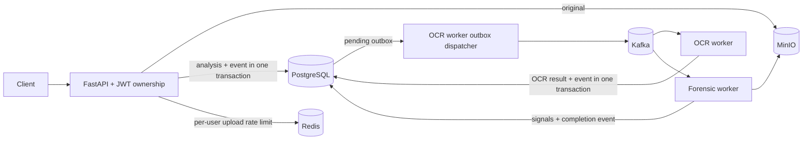

# CertiFake — certificate analysis pipeline

A backend engineering project that accepts a document, extracts labelled text with Tesseract and reports image-analysis signals through an asynchronous workflow. **It cannot establish that a certificate is genuine or fraudulent.** Confirm credentials with the issuer. OCR can be wrong and image anomalies have many benign causes.

## Architecture



The producer retries pending database events. Consumer offsets are committed synchronously after handling or a confirmed dead-letter/terminal update. PostgreSQL row locks and stage checks prevent repeat processing for the same analysis on PostgreSQL. A publish acknowledged just before a failed database commit can be published twice. This is **at-least-once intent**, not exactly-once or a zero-loss guarantee under every failure. See [distributed processing](docs/DISTRIBUTED_PROCESSING.md).

## Features and boundaries

- Register/login with bcrypt passwords and signed, expiring access tokens; status, heatmap and PDF report are owner-scoped. No refresh or server-side revocation yet.
- PNG, JPEG, WebP and PDF uploads: declared MIME, matching extension and magic bytes; image decode/pixel checks and application-level read cap. PDFs are not fully validated or malware-scanned.
- Asynchronous OCR of first PDF page or image; extracts labelled `name`, `certificate_no`, `date` and `institution` where recognized. Low-label output triggers 90°/270° trials. No calibrated field confidence.
- Image recompression/edge and OCR-quality heuristics generate signals and, where available, an ELA-style heatmap. API verdict is **Inconclusive**; compatibility score/confidence fields are null, including historical rows.
- PostgreSQL-backed outbox for upload, OCR and completion events. Redis only limits uploads; rate limiting fails open on Redis outage. Reports are generated on request, not stored in S3.

## Run locally with Docker Compose

Docker and Compose are required; the Compose defaults use **development-only** Postgres/MinIO credentials and exposed ports. Do not expose them publicly.

```bash
git clone https://github.com/rishi-1603/CertiFake.git
cd CertiFake
cp backend/.env.example .env
# Replace SECRET_KEY in .env with a random value of at least 32 bytes.
python -c 'import secrets; print(secrets.token_hex(32))'
# Paste the generated value into .env on your own machine; never commit it.
docker compose up -d --build --wait --wait-timeout 900
curl http://localhost:8000/health
# From another terminal, run the owner/other-user and upload-to-report smoke:
docker compose exec -T api-gateway python - < scripts/compose_smoke_test.py
docker compose logs -f api-gateway worker-ocr worker-forensics
# Preserve data volumes when stopping:
docker compose down
```

The app calls `create_all` with a Postgres advisory lock at startup. It creates missing tables, including the outbox table, but **does not migrate existing columns**. Back up data before upgrades; no Alembic migration history exists. Upgrade API and workers together; the OCR worker runs the dispatcher. `docker compose down -v` destroys local volumes and should only be used intentionally.

Frontend, in a second terminal:

```bash
cd frontend
npm ci
npm run dev
```

The frontend defaults to `http://127.0.0.1:8000`; set `VITE_API_URL` to your API origin if needed and configure `ALLOWED_ORIGINS` on the gateway. API docs: `http://localhost:8000/docs`.

## API quick start

1. `POST /auth/register` or `/auth/login` with JSON `email` and `password`. Use the returned bearer token in `Authorization: Bearer …`; do not share it.
2. `POST /analyze` with multipart `file`. A `202` includes `analysis_id` and means the storage write and database/outbox transaction completed; it does **not** mean Kafka has delivered the event or the analysis is ready.
3. Poll `GET /status/{id}`. Retrieve `GET /heatmap/{id}` (404 when unavailable) and `GET /report/{id}` when completed. A different owner receives 404.
4. `GET /health` is liveness only, not a dependency readiness guarantee. `GET /metrics` exposes Prometheus process and application counters.

```bash
curl -X POST http://localhost:8000/analyze \
  -H "Authorization: Bearer $ACCESS_TOKEN" -F "file=@certificate.png;type=image/png"
```

Avoid placing real tokens in shell history. Detailed schemas are in OpenAPI, generated by the running backend.

## Tests and evidence

```bash
cd backend
pip install -r requirements.txt
ruff check app tests  # install the CI-pinned ruff separately
python -m pytest -q --cov=app --cov-report=term-missing
cd ..
python scripts/evaluate_ocr.py
```

The unit/API suite uses SQLite and fakes; it does not prove a distributed stack. On 4 Nov 2026 a separate native-process run with real PostgreSQL 17, Redis 8, Kafka 3.9.1, MinIO and Tesseract 5.5 completed an upload-to-report and owner-isolation smoke, and one broker-stop/restart recovery scenario. Docker Compose and a deployed full stack were **not** run in that environment. The OCR script contains only three synthetic variations of one template; its exact-match figures must not be generalized. See [testing](docs/TESTING.md), [OCR](docs/OCR_PIPELINE.md), and [benchmarks](docs/BENCHMARKS.md).

## Known limits

No issuer verification, ground-truth fraud dataset, calibrated confidence, malware scanner, production threat assessment, login throttling, refresh tokens, reprocessing UI, migration framework or storage reconciliation. Import-time schema creation is not migrations. The upload read cap does not replace a reverse-proxy body limit or worker sandbox. Full PDF processing and resource isolation need further hardening. No p95/p99 or throughput figures have been measured.

[Audit](docs/PROJECT_AUDIT.md) · [Seven-day roadmap](docs/UPGRADE_ROADMAP.md) · [Security](docs/SECURITY.md) · [Forensics](docs/FORENSIC_ENGINE.md) · [Operations](docs/OBSERVABILITY.md) · [Interview notes](docs/INTERVIEW_PREP.md)

## Kubernetes manifests (unverified)

`k8s/deployment.yaml` is an example, not a verified deployment. It assumes externally provisioned PostgreSQL, Kafka, Redis and MinIO services and an accessible container image. Before applying it, provision a Kubernetes Secret named `certifake-secrets` with keys `database-url`, `secret-key`, `minio-access-key` and `minio-secret-key` through your cluster's approved secret manager. Do not commit Secret values or pass real secrets in shell history. The manifests, infrastructure connectivity, upgrades and failover have not been tested on a cluster; their probes are not full dependency-readiness checks.
