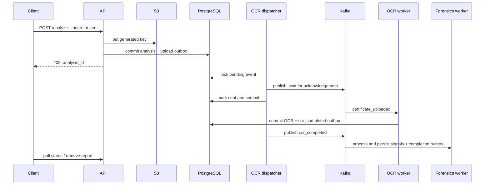

# Architecture

The authenticated FastAPI gateway writes a generated S3 object key, then commits the analysis and a `certificate_uploaded` outbox event in PostgreSQL. The OCR worker starts a separate outbox dispatcher thread that publishes pending events to Kafka; its consumer writes OCR results and an `ocr_completed` event transactionally. The forensics consumer reads the committed OCR result from PostgreSQL, writes optional heatmap to S3, and commits signals and an `analysis_completed` outbox event. The gateway generates reports on demand and checks ownership before status, heatmap or report access. Redis is a fail-open per-user upload limiter, not the job store.

202 is not completion. Object storage and database are not in a shared transaction; upload then DB failure may leave an orphan. Outbox publication and DB acknowledgement can race, so duplicate delivery is expected. Forensics heatmap upload may precede a failed DB commit, leaving an object. The completion topic has no in-repo consumer. No production high availability, migration framework or independent deployment validation is claimed.
